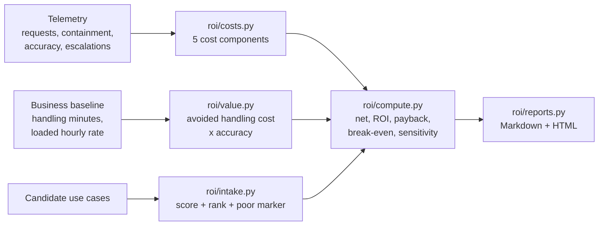

# Agent ROI Framework — what an agent earns versus what it costs

> Synthetic data only. Independent project, not affiliated with or endorsed
> by any vendor or employer. Every company, wage and volume below is
> fictional, and every figure is computed from that fictional data at run
> time by the code in this repo.

**Recruiter summary.** Teams can meter an agent's token bill to the cent
yet usually cannot answer the only question that matters: is it worth
more than it costs? This framework joins operational telemetry (requests,
containment, accuracy, escalations) to business baselines (handling time,
loaded wages) and computes ROI the way a finance reviewer would demand —
with human review, failure rework and amortised build cost all charged
to the agent, break-even containment solved rather than assumed, and a
sensitivity range instead of one flattering number. On the fictional demo
portfolio: **net $103,615.96/month, ROI 141.6%** — and one of the four use
cases honestly loses money.

## The problem

An agent's *cost* side is easy to observe and easy to understate. The
demo's own numbers show why: for the returns agent, inference is
**$1,200 of a $27,522.67 monthly cost (4%)**. The rest is people —
$18,810 of human review for escalations the agent could not finish, and
$3,591 of rework for tasks it finished wrongly — plus platform and the
month's share of an $85,000 build. Any ROI claim built on the model bill
alone is fiction.

The *value* side is usually worse: a deflection count multiplied by a
salary, with no adjustment for the deflected tasks that were resolved
incorrectly. This framework's rule is blunt — a task resolved wrong is
not value, it is a future rework bill — so an accuracy factor multiplies
every value term, and at zero accuracy the modelled value is zero.

## How it works



1. **Cost model** (`roi/costs.py`) — inference, infrastructure, human
   review of escalations, rework of failed tasks at baseline cost, and
   the period's amortised share of build cost. Components are reported
   separately; nothing is blended away.
2. **Value model** (`roi/value.py`) — baseline cost avoided on correctly
   contained tasks, plus measured handling-time savings on tasks a human
   still finished, both scaled by accuracy.
3. **Computation** (`roi/compute.py`) — net value, ROI %, cost per
   correctly resolved task versus the human cost per task, payback in
   months (explicitly *never* when monthly net is negative), break-even
   containment (bisected from the model, verified by plugging it back
   in), and a low/base/high sensitivity sweep. A use case whose plausible
   range straddles zero is flagged **fragile**.
4. **Intake gate** (`roi/intake.py`) — scores unbuilt candidates on
   volume, handling time, containment plausibility, data readiness and
   risk; low volume paired with high build complexity is marked **poor**
   outright.
5. **Reports** (`roi/reports.py`) — Markdown and HTML rendered from the
   computed values only; tests assert the rendered headline numbers equal
   the engine's, so the report cannot drift from the model.

One design decision matters throughout: scenarios are driven by the
underlying drivers, not by frozen cost rates. Raise containment and the
escalation load falls while the failure load rises, exactly as it would
in production. See `knowledge/03-value-and-break-even.md`.

## Demo results (fictional data, computed at run time)

One month at the invented retailer Cinder Peak Outfitters:

| Use case | Gross value | Total cost | Net value | ROI | Agent $/correct task | Human $/task | Payback | Break-even containment |
| --- | ---: | ---: | ---: | ---: | ---: | ---: | ---: | ---: |
| Support triage | $71,849.75 | $21,848.84 | $50,000.91 | 228.8% | $2.11 | $5.70 | 1.0 mo | 5.8% |
| Order status | $56,702.97 | $7,493.60 | $49,209.37 | 656.7% | $0.35 | $2.53 | 0.6 mo | 10.1% |
| Returns handling | $35,989.80 | $27,522.67 | $8,467.13 | 30.8% | $9.27 | $8.87 | 10.0 mo | 32.4% |
| Internal IT help | $12,231.65 | $16,293.11 | $-4,061.46 | -24.9% | $30.48 | $15.60 | never | 42.8% |
| **Portfolio** | **$176,774.17** | **$73,158.21** | **$103,615.96** | **141.6%** | | | **2.1 mo** | |

Sensitivity (pessimistic / expected / optimistic net):

| Use case | Range | Verdict |
| --- | --- | --- |
| Support triage | $27,039.92 → $81,033.79 | stable |
| Order status | $29,424.67 → $72,040.40 | stable |
| Returns handling | $-2,006.05 → $24,174.62 | **FRAGILE** — flips sign inside the plausible range |
| Internal IT help | $-7,181.83 → $1,453.99 | **FRAGILE** — negative as run, turns positive only on optimistic readings |

Intake ranking for three unbuilt candidates: product questions on the
catalogue **71.7 (strong)**, warranty claim intake **51.0 (viable)**,
a shift-swap helper for store staff **34.4 (poor — 900 requests/month
against high build complexity)**.

Two readings worth noticing. Returns handling nets positive even though
its all-in cost per correct resolution ($9.27) exceeds the human cost per
task ($8.87): the unit metric loads every cost — including reviews of
tasks the agent never claimed — onto correctly contained tasks only,
while the value side also earns assisted-time savings across 4,125
human-finished tasks. And Internal IT help is not a mystery failure: at
30% containment against a 42.8% break-even, the framework states exactly
how far it has to climb, or that it should be descoped.

## Run it

```bash
python3 demos/run_demo.py     # prints the report, writes demos/output/
python3 -m pytest tests/      # 70 tests, offline, stdlib only
python3 scripts/count_tests.py
```

No dependencies, no network, no API keys. To model your own agent,
build a `UseCase` with your drivers (see `demos/meridian.py`) and call
`roi.evaluate`, or feed measured rates straight into `roi.costs` /
`roi.value` — the implementation guide walks through both.

## Guardrails and integrity controls

- Inputs are validated at construction: rates must be fractions in
  [0, 1], money and volumes non-negative, period lengths at least one
  month. Nonsense raises immediately instead of producing a glossy
  wrong answer.
- Negative results are first-class: negative ROI prints as negative,
  payback returns `None` (rendered "never"), break-even returns `None`
  ("unreachable") when even perfect containment cannot cover costs.
- The report layer performs no arithmetic of its own; every rendered
  number is formatted from an engine output, and tests pin the two
  together.
- No personal data exists anywhere in the repo; all telemetry is
  fictional and aggregate (counts and rates, never transcripts).

## Limitations

- **Attribution is modelled, not proven.** The framework assumes the
  baseline handling time would have been spent without the agent. It
  cannot detect demand the agent created or suppressed.
- **Loaded rates are assumptions the user must supply.** A wrong wage
  assumption moves every result; that is why sensitivity varies it ±20%
  rather than hiding it.
- **Accuracy is a single input.** Real quality varies by task type; a
  production user should feed per-segment accuracy and run the model
  per segment.
- **Demo telemetry is fictional** and deliberately tidy. Its purpose is
  to exercise the model across winners, a fragile case and a loser —
  not to benchmark any real system.
- Value here is avoided handling cost only. Revenue effects, customer
  satisfaction and risk reduction are real but excluded by design,
  because they cannot be audited against a timesheet.

## Built / Written-not-run / Planned

| Item | Status |
| --- | --- |
| Cost model with 5 separated components | Built, tested |
| Value model with accuracy adjustment | Built, tested |
| Net / ROI / unit-cost / payback computation | Built, tested |
| Break-even containment solver (plug-back verified) | Built, tested |
| Sensitivity sweep with fragile flag | Built, tested |
| Intake scoring, ranking, poor-candidate marker | Built, tested |
| Markdown + HTML reports pinned to engine output | Built, tested |
| Fictional 4-use-case demo portfolio | Built, run |
| CI workflow (lint, tests, docs check, brand check) | Written, not run — added at push time by the portfolio maintainer |
| Per-segment accuracy inputs | Planned |
| Importing live trace exports as telemetry | Planned |

## Related repos

- **Jagadish-azure-finops** — optimises cloud spend itself. This repo is
  different: it asks whether the spend earns anything, for any agent on
  any platform.
- **Jagadish-agent-trace-observability** — produces per-request cost and
  cost-per-successful-request from execution traces. This framework
  consumes that style of telemetry and adds the missing half: the value
  those successful requests created, and the humans still in the loop.
- **Jagadish-llm-evals-observability** — measures whether answers are
  right; its accuracy figures are exactly the input this model needs.

## Docs

- `knowledge/` — why agent ROI is hard, the cost model, value and
  break-even thinking, and the architecture.
- `docs/implementation-guide.md` — adopting the framework on a real
  programme, including where each input should come from.
- `docs/interview-points.md` — the short version for interviews.
