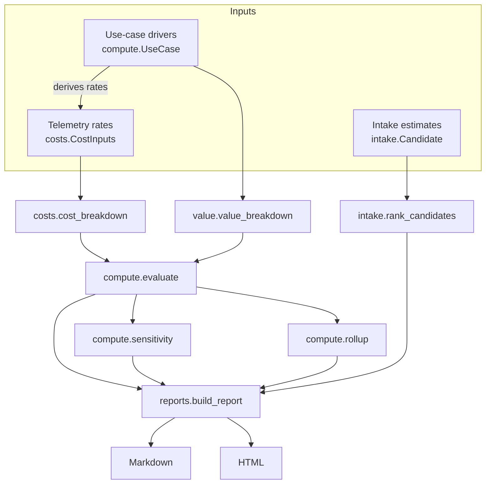

# Architecture

The codebase is a small pipeline of pure functions over frozen
dataclasses. Nothing reads the clock, the network, or the environment,
so every result is reproducible from its inputs — a property an ROI
model needs more than most, because its outputs get quoted in rooms the
author is not in.

## Module boundaries

- **`roi/costs.py`** knows nothing about value. It prices a period from
  measured rates — the right entry point when real telemetry exists.
- **`roi/value.py`** knows nothing about cost. It prices avoided human
  work from a baseline and an accuracy figure.
- **`roi/compute.py`** is the only place the two meet. Its `UseCase`
  driver object derives the measured rates that `costs.py` consumes, so
  scenario changes stay internally consistent (see note 03).
- **`roi/intake.py`** is independent of the rest: it scores candidates
  that do not exist yet, from estimates, and shares no state with the
  evaluation path beyond vocabulary.
- **`roi/reports.py`** formats and never calculates. It consumes a
  report structure built in one pass, so the Markdown and HTML can
  never disagree with each other.

## Design decisions worth defending

- **Frozen dataclasses with validation in `__post_init__`.** An ROI
  input that is physically impossible (a rate of 1.4, a negative wage)
  fails at construction, close to the person who typed it, instead of
  surfacing as a strange number three modules later.
- **`None` for impossible answers.** Payback of a money-losing agent
  and break-even of a hopeless one are `None`, rendered "never" and
  "unreachable". Returning a huge float instead would let a report
  generator format it as a date-like number and lie politely.
- **Rollups sum first, ratio second.** Portfolio ROI is total net over
  total cost. Averaging per-use-case ROIs would weight a tiny experiment
  the same as the flagship agent.
- **The report is pinned by tests.** `tests/test_reports.py` asserts
  rendered figures equal computed figures, which is what makes the
  README table safe to quote.
